# Stonks

A simulated limit-order-book exchange for human participants and independently operated trading bots. The long-term aim is a reproducible market-microstructure research environment. Assets can represent people, ideas or conventional fictional instruments; all balances are simulation units.

The exchange owns validation, price/time matching, reservations, atomic settlement and an append-only application ledger. PostgreSQL is authoritative. Redis and Socket.IO distribute committed events, with durable REST replay for reconnects. React provides market data, order entry, cancellations, fills, account positions and administration.

## System design

The current deployment runs on one VPS using Docker Compose. All six NestJS services share the live PostgreSQL database. Controlled experiments use a separate PostgreSQL server, with independent books and accounts in a fresh database for each run.

[Open the full-size diagram](docs/architecture.svg) · Editable [Mermaid source](docs/architecture.mmd) · [Architecture and request flows](docs/ARCHITECTURE.md)

| Component | Responsibility |
| --- | --- |
| React frontend | Market, order entry, portfolio, personal experiments and admin operations |
| Caddy + Nginx | Public HTTPS, certificates, static frontend files and API/Socket.IO proxying |
| API gateway | Public/authenticated HTTP routing, admin authorization and authenticated Socket.IO connections |
| User service | Registration, login, JWT issuance and transactional initial endowment |
| Wallet service | Wallet queries; settlement writes are performed by the exchange engine |
| Marketplace service | Asset submissions, catalogue and approval requests; delegates issuance to trading |
| Portfolio service | Holdings and marked portfolio queries |
| Trading service | Matching, reservations, atomic settlement, ledger, event history, command deduplication and research APIs/queue |
| Live PostgreSQL | Shared operational state, durable events, experiment manifests, run progress and results |
| Redis Pub/Sub | Broadcasts committed live-market events from trading to the gateway |
| Python research worker | Logical-time scheduling, independent SDK strategy instances and run management |
| Node research adapter + research PostgreSQL | Same exchange engine, operating on an isolated database per run |

**Order correctness:** each mutation acquires a database transaction lock, validates available cash/assets, reserves or transfers them, and commits orders, balances, ledger entries, event records and the command result together. Identical retries with the same user/key return the saved result. Concurrent commands are sequenced across assets sharing the same account.

**Live updates:** the outbox publisher sends committed events through Redis to the gateway and Socket.IO. Socket messages already contain event data, but the browser currently uses them to trigger ordered REST replay after its last event cursor; reconnect recovery and a two-second fallback check cover missed notifications. This adds a request, while keeping one recovery path. Redis Pub/Sub is not a replayable event log, and its failure does not erase committed PostgreSQL trades.

**Experiments:** the worker claims queued runs through private internal HTTP, provisions isolated run databases, calls the exchange engine through a local JSON-lines bridge and uploads progress/results. Research does not use the live market's books, balances or Redis/WebSocket timing. The strategy SDK lives in [stonks-simulation](https://github.com/avighnajha/stonks-simulation); a live-market bot adapter remains future work.

## Run

Use Node 22. Copy `.env.example` to `.env`, configure the secrets, then run `docker compose up --build`. Run `npm ci` and `npm run dev` in `frontend`. The gateway is available at `http://localhost:8080`, and Vite proxies requests to it.

For the hosted frontend and HTTPS deployment, see [the HTTPS guide](docs/HTTPS.md). **Fresh simulations:** initialise a fresh database. If you want to preserve an older local, Codespaces or deployed database, read [the upgrade procedure](docs/EXCHANGE_OPERATIONS.md) first. It refuses unresolved legacy orders/reservations rather than silently changing balances.

## Contracts and evidence

- [Participant API and recovery protocol](docs/PARTICIPANT_API.md)
- [Accounting, operations and tests](docs/EXCHANGE_OPERATIONS.md)
- [Deferred bot/simulation/research decisions](docs/RESEARCH_BACKLOG.md)
- [Research infrastructure and Python worker setup](docs/RESEARCH_OPERATIONS.md)
- [First VPS test run](docs/VPS_QUICKSTART.md)

Build the six services, set `TEST_DATABASE_URL` to a disposable PostgreSQL instance, and run `npm run test:integration` in `services/trading_service`. Tests create isolated schemas and cover concurrency, conservation, rollback, idempotency and the full HTTP flow. CI also checks service builds, unit tests and frontend types.

Current scope is cash-backed spot trading, limit orders and protected immediate-or-cancel market orders. Controlled research runs use the separate Python scheduler and isolated exchange state; the shared market uses wall time. No margin, shorting, fees or auctions are implemented. A global transaction sequencer favors correctness; throughput limits must be benchmarked before large bot runs. Historical project notes in `docs/PROJECT_CONTEXT_FULL.md` describe earlier versions and are not the current API contract.
