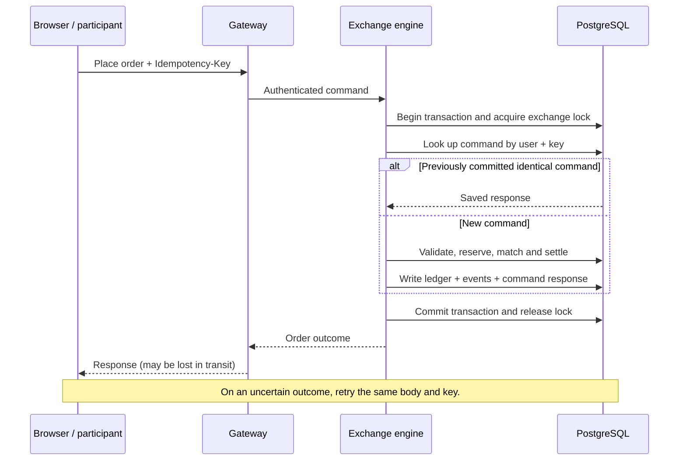

# System architecture and correctness

The [README diagram](../README.md#system-design) describes the current Compose architecture. Its editable source is [architecture.mmd](architecture.mmd). The public deployment adds Caddy and Nginx to six NestJS services; those six services share one live PostgreSQL database. Research execution uses a separate PostgreSQL server and a new database for each run.

## Orders, reservations and settlement

An order is an instruction that may wait for a counterparty. Its resources must remain available when a match arrives. A buy order moves the required cash from available to reserved; a sell order reserves units of the asset. Reservations are balances in PostgreSQL, associated with the order, rather than money sent to a different service.

For example, buying up to 10 units at $100 reserves $1,000. If all 10 trade against a resting ask at $90, $900 transfers from buyer to seller and the buyer receives 10 units. The unused $100 returns to available cash. If the order only partly fills, an open limit order retains the reservation for its remainder. Cancelling releases the unfilled remainder; a protected market order cancels its own unfilled remainder immediately.

Admission, matching, balance changes, holdings, order status, ledger entries, command response and event records commit in one PostgreSQL transaction. A failure before commit rolls the transaction back. Other transactions do not see a half-settled trade. Settlement does not call the wallet and portfolio services to perform separate transfers; the exchange engine updates the shared database directly.

Cash accounting uses exact integer arithmetic at the application boundary and fixed-precision PostgreSQL numeric columns. Prices support two decimal places, quantities four and settlement cash six. Normal trading transfers existing cash and assets; account endowments and asset issuance explicitly create supply and have their own ledger records. Marked portfolio value can change with price, so it is not a conserved cash quantity.

## Simultaneous requests

The exchange obtains the same PostgreSQL transaction-scoped advisory lock before processing a mutation. Concurrent incoming requests wait their turn at this boundary. Once a command holds the lock, it sees the effects of earlier committed commands and validates available resources before changing anything. The lock is released when its transaction commits or rolls back. Registration endowments and issuance also participate in this coordination.

This covers accounts shared across assets. With $10,000 available, two simultaneous buy orders requiring $7,500 each cannot both reserve their cash: the first admitted order leaves $2,500 and the other fails validation. A cancellation racing a fill is resolved in the same sequence: a fill already committed cannot subsequently be refunded by cancelling that filled quantity.

The global lock deliberately limits mutation throughput. It serializes exchange commands within each database; it does not serialize browser page loads, all reads, or separate research databases. Execution priority uses accepted engine sequence for ties, rather than an assumed simultaneous arrival time at the browser.

## Retried requests

Clients supply an `Idempotency-Key` for each logical command. Inside the locked transaction, the engine checks the durable `exchange_commands` record for that user and key. An identical request returns its stored response. A conflicting request receives a conflict error. A new command performs its work and stores its request/response in the same transaction as settlement.

If a response is lost after commit, the client can retry the unchanged command with the same key and retrieve the result without placing a second order. If processing rolls back before commit, there is no committed command result and retrying can attempt the operation again. Generating a new key represents a new order, even if its fields happen to match. This is protection against duplicate effects; it is not a promise that a network response always arrives.

## Redis and browser delivery

Redis is an in-memory data store supporting keys and data structures as well as messaging. Stonks currently uses its Pub/Sub messaging feature to broadcast committed exchange events from the trading service to the gateway. It is not currently the order-book database, a balance cache or the research run queue. Those records live in PostgreSQL.

The outbox publisher reads unpublished `exchange_events` every 500 ms, publishes their payloads on `EXCHANGE_EVENTS` and records publication. Because the trade and event record commit together, a committed trade has a durable event even if Redis is unavailable. Publishing failures are retried. A crash after publishing but before recording publication can cause another delivery. A successful Redis publish does not prove that a browser received it: Pub/Sub does not retain messages for disconnected subscribers. Redis AOF persistence is enabled in Compose but does not turn Pub/Sub into a replayable event log.

The gateway forwards the event payload over Socket.IO. The frontend currently uses arrival as a wakeup and retrieves `/trade/events` after its last sequence cursor. Initial loading uses `/trade/feed-snapshot`; reconnects and a two-second fallback timer also invoke recovery. Fetching a batch can recover multiple missed notifications, and events already at or before the cursor are ignored. Some screens additionally poll their own quote, history, book or account endpoints.

Notification followed by API retrieval gives the UI one ordered recovery path, at the cost of an additional HTTP request and latency. The current socket message already includes the payload, so fetching it again also duplicates bandwidth. Streaming and directly applying payloads is a valid alternative if the client handles sequence gaps, duplicates, initial snapshots and reconnect replay. Socket.IO orders delivered messages but does not, by default, replay every event missed during a disconnection. A later optimization could apply in-sequence events immediately and fetch only gaps; this is not the current implementation.

References: [Redis Pub/Sub delivery semantics](https://redis.io/docs/latest/develop/pubsub/), [Socket.IO delivery guarantees](https://socket.io/docs/v4/delivery-guarantees/).

## Research execution

The trading service stores private experiments, immutable run manifests, queue state, progress and exported results in the live database. The Python worker claims work through private `/research-worker` HTTP endpoints, which the public gateway does not route. Heartbeats maintain a lease and carry progress; completion uploads the result. The browser polls research APIs for progress and results, rather than subscribing to the live Redis market channel.

The worker runs one simulation at a time. It creates a database and restricted role on the dedicated research PostgreSQL server, then starts a Node adapter child process using the same exchange engine implementation. Python sends deterministic commands over JSON lines on stdin/stdout. Each agent has an independent strategy instance and random stream. A logical scheduler controls observations, wakeups and orders.

The run's books, accounts, orders and trades are independent of the live market. No Redis or WebSocket delivery timing controls a simulation. After export, normal completion and handled failures remove the run database; a hard kill can leave an orphan requiring operator cleanup. Installed Python strategies are trusted operator code, not sandboxed user uploads. A real-time strategy adapter for the shared public market remains future work.

## Implementation references

- [Command sequencing, idempotency and settlement](../services/trading_service/src/exchange/exchange.service.ts)
- [Transactional event publisher](../services/trading_service/src/exchange/outbox.service.ts)
- [Gateway HTTP routes](../services/api_gateway/src/proxy/proxy.controller.ts) and [Socket.IO forwarding](../services/api_gateway/src/trading/trading.gateway.ts)
- [Browser event recovery](../frontend/src/hooks/useSocket.ts)
- [Research queue and worker protocol](../services/trading_service/src/research/research.service.ts)
- [Base services](../docker-compose.yml), [research overlay](../docker-compose.research.yml), [frontend overlay](../docker-compose.frontend.yml) and [HTTPS overlay](../docker-compose.https.yml)
